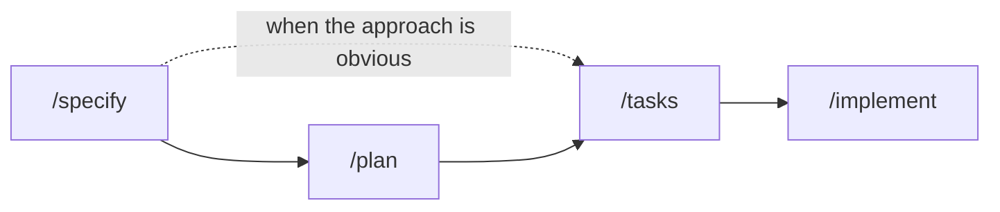

<div align="center">

# 🧭 AEP

### The Agentic Engineering Protocol

**Make correct engineering behaviour easy to discover, hard to violate, and cheap for an agent to understand.**

[](LICENSE)
[](#%EF%B8%8F-working-on-aep-itself)
[](#%EF%B8%8F-working-on-aep-itself)
[](#-quick-start)

[Quick start](#-quick-start) •
[How it works](#-how-it-works) •
[Workflow](#-the-workflow) •
[Layout](#%EF%B8%8F-repository-layout) •
[Specification](specs.md) •
[Changelog](CHANGELOG.md)

</div>

---

## 👋 What is AEP?

AEP is an **agent-agnostic, filesystem-first engineering protocol** for
AI-assisted software work. You install it into a repository, and from then on
any agent working there knows how to plan a change, build it, review it, and
hand it back to you.

All of its state is plain Markdown under `.aep/`. You can read it, diff it, and
commit it like any other file.

| | |
| --- | --- |
| 📄 **Plain files** | Everything lives in `.aep/`. No runtime, no database, no resident process. |
| 🤖 **Any agent** | Claude Code, Codex, Cursor, Gemini, and unassisted humans are all consumers. What a runtime provides is an *adapter*, never AEP. |
| 🎯 **Loads by relevance** | Every artifact says when it applies, so an agent reads what the task needs and skips the rest. |
| 🪜 **Ceremony that fits** | A typo fix is one commit. A migration gets parallel builds and two review rounds. |
| 🧑‍⚖️ **Humans decide** | Agents never merge, release, or publish. Those calls stay with you. |

> [!TIP]
> New here? Start with [Quick start](#-quick-start), then skim
> [How it works](#-how-it-works). The full reasoning behind every rule is in
> [`specs.md`](specs.md), which is written for people. An agent running AEP
> never loads it.

---

## 🚀 Quick start

AEP ships as a Claude Code plugin, published from this repository.

**1. Add the marketplace and install the plugin**

```
/plugin marketplace add saud-alnasser/aep
/plugin install aep@aep-marketplace
/reload-plugins
```

**2. Install AEP into your repository** (once per repository)

```
/aep:install
```

This writes `.aep/`, seeds the starting points your setup calls for (a
version-control rule, plus references for the tools it actually detects), and
points your entrypoint at `.aep/protocol.md`.

**3. Make your first change**

```
/aep:specify fix the typo in the README
```

The plugin namespaces every command, so the `/specify` of the workflow below is
typed `/aep:specify` in Claude Code.

> [!IMPORTANT]
> **Already running AEP 1.x?** Run `/aep:update` instead. `/aep:install` and the
> installer both refuse a 1.x repository, because 1.x has no `.aep/` and a fresh
> install would land beside the live tree and orphan everything in it.

<details>
<summary>🔧 <b>Installing without the plugin</b></summary>

<br>

Nothing about AEP requires the plugin. Run the installer directly from a
checkout of this repository:

```
node <checkout>/src/scripts/install.mjs --into <repository> --adapters claude
```

</details>

---

## 🧩 How it works

### The model

Seven primitives, the same seven `.aep/protocol.md` defines:

```
policies    what MUST be done. AEP's, protocol-owned, never edited here
rules       what MUST be done here. Yours, and an upgrade preserves them
references  how a tool or procedure is operated here
contexts    what to know about an area, and where to look
efforts     what change is being made: spec.md, plan.md, evidence/, tickets/, log.md
agents      who does the work, in what role
skills      reusable capabilities
```

Every artifact declares **when it applies** (`use-when`, `paths`), so knowledge
loads by relevance rather than by stage. Nothing tells an agent to read the
whole governance layer before starting. A policy is rigid in authority, not in
when it loads.

### 🛣️ Lanes

Each effort carries a **lane** in its spec, and the lane sets the ceremony.
Lanes only go up: a quick change that turns out to touch a public contract is
raised to standard.

| | 🟢 quick | 🟡 standard | 🔴 full |
| --- | --- | --- | --- |
| **Tickets** | none, the spec's check list is the ticket | files, built in order | files, built in waves |
| **Parallel children** | none | none | one per ticket |
| **Review** | self-check | 1 round, one reviewer | 2 rounds, two reviewers |
| **Good for** | a typo, a one-line fix | a feature in one area | a migration, a cross-cutting change |

### ⌨️ One command line

Every git and worktree step runs through one script,
`node .aep/scripts/aep.mjs`, which prints JSON the agent acts on.
`aep status` is the board: every open effort, and what is waiting on you.

### 🎫 The tracker is opt-in

With `tracker: none` (the default) nothing touches a forge, and each effort's
`log.md` is the whole record of the run.

---

## 🔁 The workflow



```
/specify → /plan? → /tasks → /implement
```

**Four commands, nothing else to type.** `refine`, `research`, `review`, and
`converge` are stages those four run for you. `prototype`, `survey`, and
`prune` are capabilities you can reach for. Pick the smallest process that
produces a reliable result.

---

## 🗂️ Repository layout

This repository is both the protocol's source and one of its consumers.

```
specs.md                  the normative specification
AGENTS.md                 the entrypoint, pointing at .aep/protocol.md
src/                      everything that ships
├── protocol.md           the bootstrap installed as .aep/protocol.md
├── policies/ skills/ agents/ templates/         protocol-owned payload
│   └── skills/<skill>/    depth read only when that skill branches to it
├── seed/                 repository-owned starting points, installed on detection
├── scripts/              install, verify, and the scripts .aep/ gets
├── gitignore             becomes .aep/.gitignore
└── adapters/<runtime>/   the committed adapters: pointers, never copies, and
                          the Claude plugin itself, its manifest and its skills
.claude-plugin/           the marketplace that publishes that adapter
.aep/                     this repository's own installation
```

> [!WARNING]
> **`src/` is the source and `.aep/` is output.** Change the protocol in `src/`,
> then reinstall. Editing `.aep/` directly changes nothing that ships, and the
> next install overwrites it.

---

## 🛠️ Working on AEP itself

There is no package manifest and no dependency. Every script is
dependency-free ESM run by a bare Node runtime.

```bash
node src/scripts/verify.mjs        # shipped surfaces against specs.md, plus a fixture install
node src/scripts/adapters.mjs      # regenerate every committed adapter
node .aep/scripts/validate.mjs     # any installed tree against the artifact contract
node .aep/scripts/index.mjs        # regenerate the discovery index
```

Agents working here start at [`AGENTS.md`](AGENTS.md), which has the rest of
the contributor workflow, including how a release is cut.

---

## 🙏 Prior work

AEP takes the **specify → plan → tasks → implement** spine from
[GitHub's Spec Kit](https://github.com/github/spec-kit) and the **composable
skill** shape from [mattpocock/skills](https://github.com/mattpocock/skills). It
depends on neither and requires neither installed.

What it adds to both: applicability metadata on every artifact, so knowledge
loads by relevance rather than by stage; a declared ownership boundary, so an
upgrade cannot eat repository knowledge; and evidence bound to the effort that
motivated it, so investigation survives the conversation.

**What is taken from each is a shape, not text.** AEP vendors no code or prose
from either project, because every shipped file was written for this protocol,
so no third-party licence condition attaches to it.

<details>
<summary>📜 <b>Coming from AEP 1.x</b></summary>

<br>

AEP 1.x was a Claude Code skill framework rooted in `.claude/`. 2.0 was a
rewrite of the framework, so none of it upgrades in place. `specs.md` §33 lists
what was removed and what replaced it.

A 1.x repository's **own** knowledge does move across: `/aep:update` detects the
old layout and runs a carry-across that installs fresh, re-homes the contexts,
tool guides, specs, tickets, and evidence, and reports every assumption it made
on your behalf.

</details>

---

## 📄 Licence

Apache 2.0. See [LICENSE](LICENSE).
